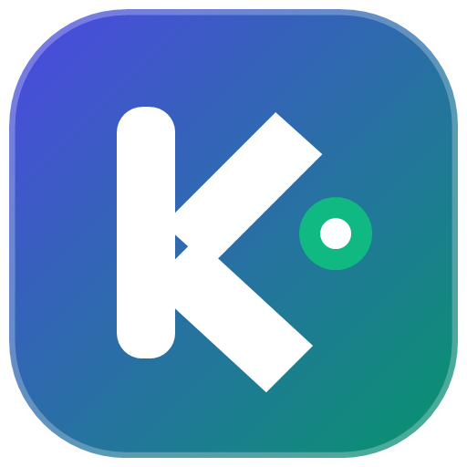
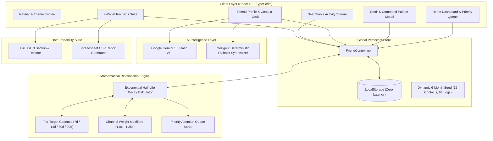

<div align="center">
  
  
  # KeenKeeper v2.0
  ### Production-Grade Personal CRM & Algorithmic Relationship Intelligence Platform

  [](https://www.typescriptlang.org/)
  [](https://react.dev/)
  [](https://vitejs.dev/)
  [](https://tailwindcss.com/)
  [](https://recharts.org/)
  [](https://ai.google.dev/)
  [](https://b13-a7-keen-keeper-atahar-shihab.vercel.app/)
  [](LICENSE)

  <p align="center">
    <strong>Turn Dunbar's number into an unfair advantage.</strong><br />
    Nurture deep personal and professional connections through mathematical half-life cadences, instant keyboard logging, and AI relationship briefings.
  </p>

  <p align="center">
    🚀 <strong>Live Demo:</strong> <a href="https://b13-a7-keen-keeper-atahar-shihab.vercel.app/">https://b13-a7-keen-keeper-atahar-shihab.vercel.app/</a>
  </p>

  <p>
    <a href="#-live-deployment">Live Demo</a> •
    <a href="#-system-architecture">System Architecture</a> •
    <a href="#-mathematical-health-decay-formula">Health Decay Engine</a> •
    <a href="#-core-feature-suite">Feature Breakdown</a> •
    <a href="#-git--github-engineering-workflow">Engineering Workflow</a> •
    <a href="#-quickstart--local-setup">Setup Guide</a>
  </p>
</div>

---

## 🧭 Overview & Core Problem Statement

Human memory degrades over time; so do unmaintained relationships. As professional and personal networks grow, the natural entropy of daily life causes high-value friendships, mentors, and collaborators to quietly drift away.

Traditional CRMs (Salesforce, HubSpot) are transactional sales funnels. Traditional to-do apps (Todoist, Notion) lack temporal decay models.

**KeenKeeper v2.0** bridges this gap: a keyboard-first, client-side personal CRM powered by an **exponential half-life decay engine**. It monitors days elapsed since last contact relative to customizable circle tier targets, highlights drifting relationships in a priority queue, synthesizes conversation history using Google Gemini, and enables complete data ownership via JSON/CSV exports.

---

## 🌐 Live Deployment

KeenKeeper v2.0 is deployed in production on Vercel:  
👉 **[https://b13-a7-keen-keeper-atahar-shihab.vercel.app/](https://b13-a7-keen-keeper-atahar-shihab.vercel.app/)**

- **Client-Side SPA Routing**: Fully configured via `vercel.json` rewrites for refreshable deep links (`/friend/:id`, `/timeline`, `/stats`).
- **Zero-Latency Local Persistence**: Real-time `localStorage` state synchronization with instant offline fallback.
- **Recruiter Demo Sandbox**: One-click "Reset Demo Data" trigger in the Navbar to restore the 12-contact, 63-log CRM dataset at any time.

---

## 🏛 System Architecture

The following diagram illustrates KeenKeeper's unidirectional data flow, mathematical decay engine, and dual-layer AI copilot architecture:



---

## 📐 Mathematical Health Decay Formula

KeenKeeper evaluates relationship health using an exponential decay model where the relationship score reaches a **half-life of 50%** when elapsed time ($\Delta t$) equals the target cadence ($C$):

$$\text{Health Score} = \text{clamp}\left(\text{round}\left(100 \times w_{\text{channel}} \times e^{-0.693 \times \frac{\Delta t}{C}}\right), 0, 100\right)$$

### Parameters & Weight Modifiers:
- $\Delta t$: Days elapsed since the most recent interaction with the contact.
- $C$: Target check-in cadence defined by Circle Tier:
  - **Inner Circle**: $C = 7\text{ days}$
  - **Close Friends**: $C = 14\text{ days}$
  - **Key Network**: $C = 30\text{ days}$
  - **Acquaintances**: $C = 90\text{ days}$
  *(Can be overridden on a per-contact basis via `customCadenceDays`)*
- $w_{\text{channel}}$: Interaction channel depth multiplier:
  - **In-Person**: $1.25\times$ (High-touch bonding)
  - **Video Call**: $1.15\times$ (Visual telepresence)
  - **Phone Call**: $1.08\times$ (Real-time voice sync)
  - **Message / Text**: $1.00\times$ (Standard baseline)

### Dynamic Status Classification:
| Status | Score Range | Meaning & Action Trigger |
| :--- | :---: | :--- |
| **Thriving** | `80 – 100` | Fresh interaction within target cadence benchmark. |
| **Steady** | `50 – 79` | Healthy connection; cadence window nearing threshold. |
| **Drifting** | `25 – 49` | Cadence exceeded; automatically queued in **Needs Attention**. |
| **Overdue** | `0 – 24` | Urgent outreach required; ranked at top of priority queue. |

### Priority Attention Urgency Formula:
$$\text{Urgency} = (100 - \text{Health Score}) \times \text{Tier Priority Weight}$$
Where **Inner Circle** = 4, **Close Friends** = 3, **Key Network** = 2, **Acquaintances** = 1.

---

## ✨ Core Feature Suite

### 1. Priority "Needs Attention Today" Queue (`Home.tsx`)
- Automatically evaluates network health in real-time.
- Surfaces drifting and overdue contacts in an urgent horizontal action reel with single-click check-in buttons and days-overdue indicators.
- Executive KPI summary tracks Average Network Health, 12-week consistency streak, and monthly interaction totals.

### 2. Global Command Palette & Quick Check-In (`Cmd+K` / `Ctrl+K`)
- Accessible anywhere in the application with instant keyboard shortcuts (`Cmd+K` / `Ctrl+K` or Navbar trigger).
- Keyboard-first contact search with arrow navigation and Enter selection.
- Log check-ins in under 5 seconds with channel selection, conversation depth (`Deep Talk`, `Catch-Up`, `Quick Sync`), context takeaways, optional follow-up task creation, and confetti celebration.

### 3. AI Relationship Copilot (`src/lib/aiCopilot.ts`)
- **Dual-Engine Architecture:**
  - **Google Gemini 1.5 Flash:** Invoked automatically when `VITE_GEMINI_API_KEY` is configured.
  - **Smart Deterministic Synthesizer:** Zero-config fallback that analyzes historical notes, days elapsed, milestones, and open promises. Ensures 100% reliable recruiter demos without requiring API keys or internet access.
- **Pre-Call Executive Briefing:** 3-bullet briefing detailing recent conversation highlights, open commitments, and suggested topics.
- **Contextual Icebreaker Generator:** 3 copyable message templates (*Casual Check-In*, *Warm Reconnect*, *Milestone Follow-Up*) tailored to the contact's context.

### 4. Contact Profile & Context Vault (`FriendDetails.tsx`)
- **Health Radial Gauge:** Visual SVG gauge, live status pill, and cadence tier selector.
- **Context Vault:** Pinned milestones (birthdays, anniversaries), gift ideas, and personal context notes.
- **Follow-Up Action Items:** Interactive checklist of promises made during conversations.
- **Historical Activity Feed:** Chronological interaction stream specific to the contact.

### 5. Searchable Activity Stream (`Timeline.tsx`)
- Multi-dimensional filtering by Relationship, Channel (`In-Person`, `Video`, `Call`, `Text`), Depth (`Deep Talk`, `Catch-Up`, `Quick Sync`), and Date Range (`7d`, `30d`, `90d`, `All Time`).
- Full-text search across interaction notes and topic tags.
- Inline modal editing and instant deletion with real-time health score recalculation.

### 6. Executive Recharts Analytics Suite (`Stats.tsx`)
- **12-Week Momentum AreaChart:** Dual-area weekly volume chart tracking overall velocity and deep conversations.
- **Channel Mix Donut Chart:** Inner-radius donut chart breaking down proportional communication channels.
- **Circle Tier Health vs. Benchmark:** Side-by-side bar chart evaluating current average tier health against target benchmarks.
- **Drifting Watchlist:** Real-time roster of relationships falling below healthy thresholds.

### 7. Data Portability & Sandbox Controls (`src/lib/dataPortability.ts`)
- **JSON Backup & Restore:** Complete serialized export/import of contacts, interactions, and tasks.
- **CSV Spreadsheet Report:** Clean spreadsheet export for external CRM analysis.
- **One-Click Demo Reset:** Instantly restore the rich 12-contact, 63-interaction, 6-month benchmark dataset at any time.

---

## 📂 Project Directory Structure

```text
src/
├── components/
│   ├── analytics/              # Recharts analytical visualization modules
│   │   ├── AtRiskList.tsx      # Drifting & overdue watch list
│   │   ├── ChannelDonut.tsx    # Channel distribution donut chart
│   │   ├── CircleHealthChart.tsx# Tier health vs benchmark bar chart
│   │   └── MomentumAreaChart.tsx# 12-week velocity area chart
│   ├── command/
│   │   └── CommandPalette.tsx  # Global Cmd+K quick check-in & search modal
│   ├── common/
│   │   ├── AddFriendModal.tsx  # Contact enrollment modal
│   │   ├── Footer.tsx          # System telemetry and copyright footer
│   │   ├── Navbar.tsx          # Sticky navigation with shortcut triggers
│   │   └── ThemeToggle.tsx     # Light/Dark mode toggle
│   ├── dashboard/
│   │   ├── FilterSortBar.tsx   # Multi-tier filter pills & sort dropdown
│   │   ├── FriendCard.tsx      # Radial health gauge contact card
│   │   ├── KPISummary.tsx      # Executive metrics overview bar
│   │   └── NeedsAttentionQueue.tsx # Priority urgent outreach carousel
│   ├── profile/
│   │   ├── AIBriefingCard.tsx  # Gemini & synthesizer copilot UI
│   │   ├── ActionItemsChecklist.tsx # Follow-up promises checklist
│   │   ├── ContextVault.tsx    # Milestones, gift ideas, and context notes
│   │   └── HealthGauge.tsx     # Profile health gauge & cadence editor
│   └── timeline/
│       └── InteractionEditModal.tsx # Inline touchpoint editing modal
├── context/
│   └── FriendContext.tsx       # Central state store with LocalStorage sync
├── data/
│   └── seedData.ts             # 6-month benchmark dataset (12 contacts, 63 logs)
├── lib/
│   ├── aiCopilot.ts            # Gemini API service + deterministic synthesizer
│   ├── dataPortability.ts      # JSON backup & CSV report utilities
│   └── relationshipEngine.ts   # Mathematical decay formulas & metrics
├── pages/
│   ├── FriendDetails.tsx       # Contact deep-dive CRM & AI copilot
│   ├── Home.tsx                # Executive dashboard & filterable directory
│   ├── NotFound.tsx            # 404 recovery route
│   ├── Stats.tsx               # 4-panel Recharts analytics suite
│   └── Timeline.tsx            # Searchable activity ledger with CRUD
├── types/
│   └── index.ts                # Domain models & strict TypeScript interfaces
├── App.tsx                     # Router layout & global shortcut listeners
├── index.css                   # Tailwind CSS styling & root theme variables
└── main.tsx                    # Application entry point
```

---

## ⚡ Quickstart & Local Setup

### Prerequisites
- Node.js `v18.0.0+` or `v20.0.0+`
- npm `v9.0.0+`

### 1. Clone & Install
```bash
git clone https://github.com/Atahar-Shihab/B13-A7-keen-keeper_Atahar-Shihab.git
cd B13-A7-keen-keeper_Atahar-Shihab
npm install
```

### 2. Environment Configuration (Optional)
KeenKeeper includes a built-in deterministic AI synthesizer that works 100% offline out-of-the-box. To enable live calls to Google Gemini:

```bash
cp .env.example .env
```
Edit `.env` and supply your Gemini API key:
```env
VITE_GEMINI_API_KEY=your_actual_gemini_api_key
```

### 3. Launch Development Server
```bash
npm run dev
```
Open [http://localhost:5173](http://localhost:5173) in your browser.

### 4. Build for Production & Typecheck
```bash
npm run typecheck
npm run build
```

---

## 🛡 Git & GitHub Engineering Workflow

KeenKeeper v2.0 was developed following strict production git hygiene. Every commit is atomic, typed, and merged via non-fast-forward (`--no-ff`) merges to preserve the feature branch topology:

### Branching Matrix
- `chore/typescript-architecture-setup` — TypeScript configuration, domain types, and dynamic seed dataset.
- `feat/relationship-decay-engine` — Exponential health decay engine and persistent state store.
- `feat/dashboard-and-command-palette` — Global `Cmd+K` command palette, priority queue, and filterable directory.
- `feat/profile-vault-and-ai-copilot` — Context vault, AI briefings/icebreakers, and timeline stream.
- `feat/analytics-suite-and-export` — 4-panel Recharts suite and JSON/CSV data portability.
- `docs/readme-and-final-polish` — 404 route polish, responsive testing, and system documentation.

### Conventional Commit Standard
All commits strictly adhere to:
`<type>(<scope>): <imperative summary under 72 characters>`

Examples from repository history:
```text
chore(ts): configure TypeScript types and modular project architecture
feat(seed): add dynamic 6-month CRM seed dataset with 12 contacts and 60+ logs
feat(engine): implement exponential relationship health decay and cadence engine
feat(store): create persistent CRM state store with CRUD and demo reset
feat(layout): upgrade navbar with command trigger, theme toggle, and sandbox controls
feat(command): build global Cmd+K quick check-in and search modal
feat(dashboard): implement priority attention queue and filterable friend grid
feat(ai): implement Gemini AI relationship briefing and icebreaker generator
feat(profile): build contact context vault, action items checklist, and AI copilot UI
feat(timeline): add multi-filter searchable activity stream with inline CRUD
feat(portability): add JSON backup import/export and CSV report generator
feat(analytics): build 4-panel Recharts analytics dashboard and drifting watchlist
fix(ui): polish responsive states, 404 route, and environment template
docs(readme): write comprehensive architecture and product documentation
```

---

## 👤 Author
**Atahar Shihab**  
- GitHub: [@Atahar-Shihab](https://github.com/Atahar-Shihab)
- Project: [B13-A7-keen-keeper_Atahar-Shihab](https://github.com/Atahar-Shihab/B13-A7-keen-keeper_Atahar-Shihab)