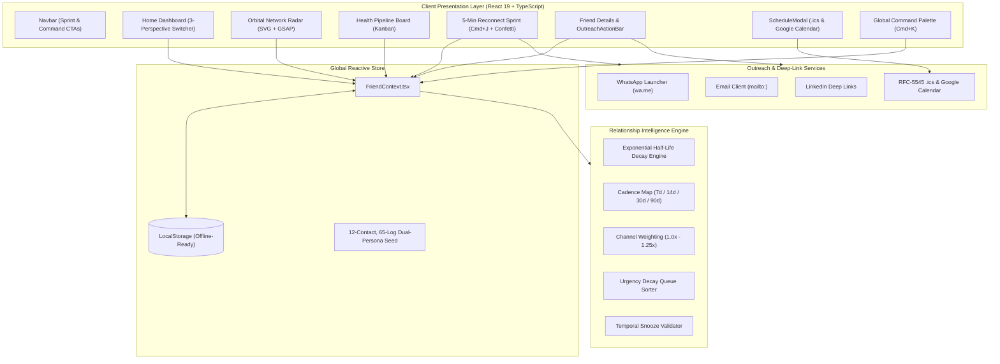

<div align="center">
  
  
  # KeenKeeper Flagship Edition
  ### Personal & Career Relationship Intelligence OS

  [](https://github.com/Atahar-Shihab)
  [](https://keen-keeper-shihab.vercel.app/)
  [](https://b13-a7-keen-keeper-atahar-shihab.vercel.app/)
  [](https://www.typescriptlang.org/)
  [](https://react.dev/)
  [](https://gsap.com/)
  [](LICENSE)

  <p align="center">
    <strong>Turn relationship entropy into an unfair career and life advantage.</strong><br />
    A Linear/Raycast-caliber Relationship Intelligence OS powered by custom GSAP motion choreography, an exponential half-life decay engine, an interactive Solar Orbital Network Radar, a 5-minute Reconnect Sprint, and 1-click calendar & outreach deep-links.
  </p>

  <p align="center">
    🚀 <strong>Primary Production URL:</strong> <a href="https://keen-keeper-shihab.vercel.app/">https://keen-keeper-shihab.vercel.app/</a><br />
    🌐 <strong>Coursework Production URL:</strong> <a href="https://b13-a7-keen-keeper-atahar-shihab.vercel.app/">https://b13-a7-keen-keeper-atahar-shihab.vercel.app/</a>
  </p>

  <p>
    <a href="#-executive-summary">Executive Summary</a> •
    <a href="#-high-craft-motion--ui-stack">Motion & UI Primitives</a> •
    <a href="#-core-feature-suite">Core Features</a> •
    <a href="#-system-architecture">Architecture</a> •
    <a href="#-mathematical-decay-engine">Decay Engine</a> •
    <a href="#-keyboard-shortcuts">Shortcuts</a> •
    <a href="#-git--github-engineering-workflow">Git Workflow</a> •
    <a href="#-local-setup">Setup Guide</a>
  </p>
</div>

---

## 🧭 Executive Summary

Human memory naturally decays; without intentional systems, so do relationships. Traditional CRMs (*Salesforce*, *HubSpot*) treat people as transactional sales pipelines. Traditional to-do apps (*Todoist*, *Notion*) lack decay modeling and cadence physics.

**KeenKeeper Flagship Edition** transforms relationship stewardship into a daily, high-agency discipline:
1. **Mathematical Decay Modeling:** Calculates relationship health dynamically using exponential half-life equations calibrated to custom circle tier cadences.
2. **Dual-Persona Workspace:** Toggle effortlessly between **Personal Circle** (friends, family, hobby partners) and **Career & Mentors** (engineering managers, thesis advisors, startup founders, recruiters).
3. **Living Solar System Visualization:** An interactive SVG + GSAP **Orbital Network Radar** maps relationships across 4 concentric cadence rings with pulsing beacon alerts for drifting contacts.
4. **5-Minute "Weekly Reconnect Sprint" (`Cmd+J`):** A guided card deck that identifies top drifting contacts, generates tone-tailored messages via AI, and opens **WhatsApp, Email, or LinkedIn** in 1 click—ending with celebratory confetti.
5. **1-Click Calendar Scheduling:** Download RFC-5545 `.ics` files with built-in reminders or launch Google Calendar pre-populated with AI Catch-Up Briefings and pending action items.

---

## 🎨 High-Craft Motion & UI Stack

Every interaction in KeenKeeper is crafted to feel tactile, responsive, and alive:

| Technology | Implementation & Role |
| :--- | :--- |
| **GSAP & `@gsap/react`** | Staggered bento grid entrances, radial SVG stroke-dashoffset health sweeps (`HealthRing`), numeric counter tweens (`AnimatedCounter`), and celestial orbit entrance animations in `OrbitalRadar`. |
| **Framer Motion** | Physics-based spring segmented tab pills (`layoutId="personaActiveTab"` and `layoutId="viewActiveTab"`), slide-over inspector drawers, and Reconnect Sprint card transitions. |
| **Lenis (`@studio-freight/lenis`)** | Smooth inertial momentum wheel scrolling across all dashboard and detail pages. |
| **Spotlight BCP Cards** | Mouse-tracking dynamic radial spotlight glows (`SpotlightCard`) that track the cursor on glassmorphic dark carbon and crisp alabaster surfaces. |
| **Sonner** | Rich, non-blocking toast notifications for outreach launches, check-in logs, snooze confirmations, and data imports. |
| **Canvas Confetti** | Multi-vector particle confetti cannon bursts upon completing the 5-Minute Weekly Reconnect Sprint. |
| **Tailwind CSS + DaisyUI** | Dark-first carbon aesthetic (`#090A0F`), crisp light theme, and high-contrast accessibility tags. |

---

## ⚡ Core Feature Suite

### 1. Dual-Persona Relationship Workspace
Contacts are categorized into distinct relationship spheres:
- **Personal Circle:** Childhood friends, roommates, athletic partners, creative confidantes.
- **Career & Mentors:** Staff architects, engineering managers, VC investors, thesis advisors, and tech founders.
- Seamlessly filter the entire OS via `PersonaSwitcher` across Bento Grid, Orbital Radar, Kanban Board, and Analytics.

### 2. Interactive SVG + GSAP Orbital Network Radar
Visualizes relationships as a living planetary solar system:
- **Nucleus:** Center glowing node representing **YOU**.
- **4 Concentric Cadence Orbits:**
  - `Inner Circle` (Radius 105px — 7-day cadence)
  - `Close Friends` (Radius 185px — 14-day cadence)
  - `Key Network` (Radius 265px — 30-day cadence)
  - `Acquaintances` (Radius 345px — 90-day cadence)
- **Visual Decay Beacons:** Contacts decaying past cadence thresholds trigger pulsating radar ripples.
- **Glassmorphic Node Inspector:** Clicking any node reveals avatar, health ring, last contact telemetry, and 1-click outreach triggers.

### 3. 5-Minute "Weekly Reconnect Sprint" (`Cmd+J` / `Ctrl+J`)
- Designed for busy professionals to prevent drifting relationships in under 5 minutes.
- Selects the top 3–5 highest-urgency drifting relationships using tier-weighted decay rank.
- **AI Draft Reconnect Synthesizer:** Choose between **Casual**, **Warm Reconnect**, or **Professional** tones with real-time editing.
- **1-Click Multi-Channel Launchers:**
  - 🟢 **WhatsApp:** Launches `https://wa.me/<phone>?text=...` with prefilled message and auto-logs the touchpoint.
  - 🔵 **Email:** Launches `mailto:<email>?subject=...&body=...` prefilled with context.
  - 🔷 **LinkedIn:** Direct profile message deep link.
  - 🌙 **Snooze 7d:** Postpones the contact from sprint queues.
- Celebratory confetti finale with metric summary.

### 4. 1-Click Calendar Scheduling (`.ics` & Google Calendar)
- **RFC-5545 Standard `.ics` Generator:** Triggers browser download of universal iCalendar invites with 15-minute alert reminders (`VALARM`).
- **Google Calendar Web Integration:** Opens pre-filled calendar events with custom meeting titles, durations, video call locations, and discussion agendas derived from Context Vault notes.

### 5. Health Kanban Pipeline Board
- 4 pipeline columns: `Overdue (< 25%)` → `Drifting (25–49%)` → `Steady (50–79%)` → `Thriving (80–100%)`.
- Instant contact card inspection with 7-day snooze buttons, days elapsed, and quick check-in logging.

### 6. Global Command Palette (`Cmd+K` / `Ctrl+K`)
- Omnipresent modal for instant relationship search, check-in logging, follow-up task assignment, and rapid new contact enrollment.

### 7. Google Gemini AI Copilot + Deterministic Fallback
- Generates 3-bullet Catch-Up Briefings and tailored conversation icebreakers.
- Guaranteed reliability: if `VITE_GEMINI_API_KEY` is not configured, the local deterministic rule-based synthesizer activates instantly with zero UI disruption.

---

## 🏛 System Architecture



---

## 📐 Mathematical Decay Engine

KeenKeeper models relationship health using continuous exponential half-life decay. Health degrades naturally over time unless refreshed by logged interactions:

$$\text{HealthScore} = \text{clamp}\left( \text{round}\left( 100 \times w_{\text{channel}} \times e^{-0.693 \times \frac{\Delta t}{C}} \right), 0, 100 \right)$$

Where:
- $\Delta t$: Days elapsed since the most recent contact date.
- $C$: Target cadence in days (Inner Circle = 7, Close Friends = 14, Key Network = 30, Acquaintances = 90, or custom override).
- $w_{\text{channel}}$: Interaction channel quality modifier:
  - **In-Person:** $1.25\times$
  - **Video Call:** $1.15\times$
  - **Voice Call:** $1.08\times$
  - **Text / Asynchronous:** $1.00\times$

### Tier-Weighted Priority Attention Formula
Contacts needing attention are prioritized by urgency weighted by circle importance:

$$\text{UrgencyScore} = (100 - \text{HealthScore}) \times w_{\text{tier}}$$

Where $w_{\text{tier}}$ equals $4$ for Inner Circle, $3$ for Close Friends, $2$ for Key Network, and $1$ for Acquaintances. Snoozed contacts are gracefully deferred until their snooze period expires.

---

## ⌨️ Keyboard Shortcuts

| Shortcut | Description | Context |
| :--- | :--- | :--- |
| <kbd>⌘</kbd> + <kbd>K</kbd> / <kbd>Ctrl</kbd> + <kbd>K</kbd> | Open Global Quick Check-In Command Palette | Anywhere in OS |
| <kbd>⌘</kbd> + <kbd>J</kbd> / <kbd>Ctrl</kbd> + <kbd>J</kbd> | Launch 5-Minute Weekly Reconnect Sprint | Anywhere in OS |
| <kbd>Esc</kbd> | Close Command Palette, Sprint, or Schedule Modal | Open Modals |
| <kbd>↑</kbd> / <kbd>↓</kbd> + <kbd>Enter</kbd> | Navigate and select contacts in Command Palette | Command Palette |

---

## 🛠 Tech Stack

- **Framework:** React 19 + TypeScript (Strict Mode)
- **Bundler & Tooling:** Vite 8, PostCSS, ESLint
- **Styling:** Tailwind CSS 3.4, DaisyUI 5, Lucide React
- **Motion & Dynamics:** GSAP 3.14, `@gsap/react`, Framer Motion 12, Lenis 1.1
- **Visuals & Feedback:** Recharts 3.8, Sonner 2.0, Canvas Confetti
- **Deployment:** Vercel with SPA routing rewrite (`vercel.json`)

---

## 🌿 Git & GitHub Engineering Hygiene

KeenKeeper v2.0 was developed following strict production engineering standards:
- **No direct commits to `main`**: All work performed on isolated feature branches (`feat/`, `chore/`, `docs/`).
- **Conventional Commits**: Every commit strictly follows `<type>(<scope>): <imperative summary under 72 chars>`.
- **Atomic Staging**: Files staged selectively by module (`git add <specific-files>`).
- **Build Verification**: Every branch verified with `tsc --noEmit` and `npm run build` with zero errors prior to merge.
- **Visible Topology**: Non-fast-forward merges (`git merge --no-ff`) preserve feature branch history in the GitHub network graph.

---

## 🚀 Quickstart & Local Setup

### Prerequisites
- Node.js `v18.0.0` or higher
- npm or yarn

### Installation
```bash
# Clone the repository
git clone https://github.com/Atahar-Shihab/B13-A7-keen-keeper_Atahar-Shihab.git
cd B13-A7-keen-keeper_Atahar-Shihab

# Install dependencies
npm install

# (Optional) Create environment file for Google Gemini AI Copilot
echo "VITE_GEMINI_API_KEY=your_gemini_api_key_here" > .env

# Start development server
npm run dev
```

### Production Build & Type Verification
```bash
# Run strict TypeScript validation
npx tsc --noEmit

# Compile production bundle
npm run build

# Preview production build locally
npm run preview
```

---

## 👤 Author & Acknowledgments

**Atahar Shihab**  
- Portfolio / GitHub: [github.com/Atahar-Shihab](https://github.com/Atahar-Shihab)  
- Live Application: [keen-keeper-shihab.vercel.app](https://keen-keeper-shihab.vercel.app/)

Designed and built as a flagship demonstration of modern frontend architecture, mathematical decay modeling, and high-craft motion design.